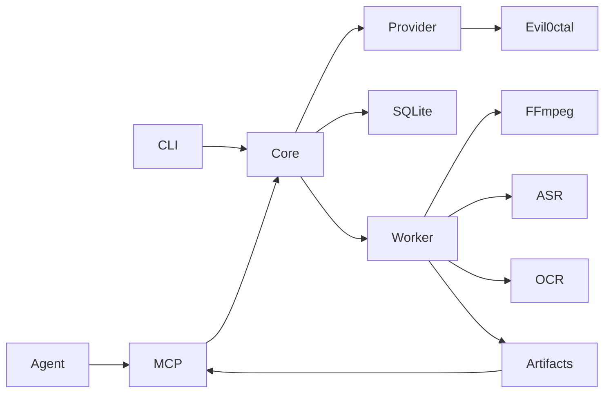

# Architecture

CLI and MCP stdio clients call a shared TypeScript application service. A registered provider resolves a public URL and supplies a candidate media stream. A restricted downloader hands a local file to one Python subprocess. SQLite tracks work and the filesystem holds per-task artifacts.

The provider endpoint and credentials belong to the operator. The external API has its own database and queue. Only the adapter knows its envelope. Raw identity material, signed stream URLs and untrusted platform payloads must stay out of output and logs. The worker accepts local MP4 input from the pipeline. Its output links each text segment or frame to media time in seconds. The client interprets evidence and cites timestamps.
