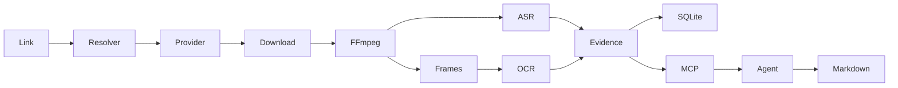

# AgentMediaLens

**Multimodal Media Understanding Infrastructure for AI Agents.** Give Agents the Ability to Understand Media.

[简体中文](README.zh-CN.md) · [Verification status](IMPLEMENTATION_STATUS.md) · [Architecture](ARCHITECTURE.md)

AgentMediaLens accepts public Douyin video links and prepares timestamped speech, keyframes and OCR for a local agent. Codex can request individual JPEGs and write its interpretation to Markdown. The first release is in development. The installed plugin has been exercised with generated English tutorial footage. Live public-video acceptance is tracked separately.



## Install from source

Use Node 24 LTS (24.12+), pnpm 11.5, Python 3.12, uv, FFmpeg/ffprobe, and Tesseract with eng and chi_sim. On Debian/Ubuntu install ffmpeg, tesseract-ocr-eng and tesseract-ocr-chi-sim. On macOS Homebrew provides ffmpeg, tesseract and tesseract-lang. The runtime stores weights separately and downloads a missing Whisper model on first voiced analysis.

```sh
git clone https://github.com/1122414/agent-media-lens.git
cd agent-media-lens
pnpm install --frozen-lockfile
uv sync --frozen --python 3.12
pnpm build
sh scripts/install-launchers.sh
export PATH="$HOME/.local/bin:$PATH"
media-lens doctor
```

Doctor checks local binaries and the configured provider. For Evil0ctal it exits with status 1 if the API is unreachable, the key lacks access, or the Douyin pool has no available identities. An OK check does not establish download permission for a particular video. Link identification and existing-task evidence reads work independently.

## Providers and configuration

Follow the [Douyin setup](docs/providers/douyin.md) for an independent Evil0ctal v5 service. Keep its least-privilege key in EVIL0CTAL_API_KEY. Pass a JSON config path via MEDIA_LENS_CONFIG. Set MEDIA_LENS_CACHE and EVIL0CTAL_ENDPOINT to override the file. The optional MEDIA_LENS_PYTHON selects a worker interpreter. Run `media-lens config` to print effective settings. Keys never appear in config output.

| Setting | Default | Purpose |
|---|---|---|
| provider / fallback | evil0ctal / false | Choose provider; optional native fallback on connection failure |
| endpoint | http://127.0.0.1:8000 | Trusted v5 origin |
| cacheDir | ~/.cache/agent-media-lens | Private task directory and SQLite database |
| maxSeconds / maxBytes | 600 / 500000000 | Metadata, download and decode bounds |
| maxDiskBytes / concurrency | 10000000000 / 1 | Task admission |
| retentionDays | 7 | Expiry of original video at admission or explicit cleanup |
| interval / maxFrames | 4 seconds / 30 | Baseline sampling and frame cap |
| model / device | auto / auto | CPU base int8 or CUDA small FP16; manual overrides supported |
| ocrLang | chi_sim+eng | Installed Tesseract languages |

```sh
media-lens identify "$SHARE_URL"
media-lens resolve "$SHARE_URL"
media-lens analyze "$SHARE_URL" --model base --max-frames 12
media-lens task "$TASK_ID"
media-lens transcript "$TASK_ID"
media-lens frames "$TASK_ID" --markdown
media-lens result "$TASK_ID"
media-lens cleanup
```

For one-shot processing, add --discard-original to analyze or pass discardOriginal: true to media_analyze.

## Codex and other MCP clients

From the checkout, install the launchers, ensure the desktop app can find media-lens-mcp on PATH, and run:

```sh
codex plugin marketplace add .
codex plugin add agent-media-lens@agent-media-lens-local
codex plugin list --marketplace agent-media-lens-local --json
```

Start a fresh chat. Ask “Summarize this public Douyin video and cite the relevant frames”, or “Analyze existing task TASK_ID”. The skill reads the transcript, samples images on demand and saves analysis.md beside the result. A generated tutorial example produced “Open the settings menu [0–4s]” supported by a white card reading “STEP ONE OPEN SETTINGS” [0s · f000]. See [verification](docs/development/testing.md).

For other stdio clients configure `{"mcpServers":{"media":{"command":"media-lens-mcp"}}}` and pass the operator environment to the process. See [tool reference](docs/architecture/data-contracts.md).

## Docker

```sh
docker compose build
docker compose run --rm lens --help
docker compose run --rm -T --entrypoint node lens dist/apps/mcp-server/main.js
```

The core has no published port. Files and models persist in the media-data volume. From a container, loopback addresses the container itself. Configure an operator-controlled HTTPS provider reachable from the container for live processing. On Homebrew installations with the standalone Compose binary, substitute `docker-compose`.

## FAQ

- **A share opens a photo note.** Identify returns its ID. The first video pipeline rejects albums with UNSUPPORTED_MEDIA.
- **Why did the adapter refuse a playable link?** It requires explicit public visibility and permission to download in the provider response. Missing fields, revoked links and access controls can stop processing.
- **Can I use native only?** It identifies direct and shortened shares. Native metadata and downloads report NATIVE_UNSUPPORTED.
- **Where is analysis saved?** Each UUID directory contains result.json, transcript.json, evidence.json, JPEGs and analysis.md. Read cached media only in a private directory owned by the operator. No per-user access control is provided for a shared cache.
- **What happens when disk admission fails?** Cleanup expires originals; derived evidence remains. Archive terminal task directories offline before manually removing them. Stop running clients before editing the cache.

[Roadmap](ROADMAP.md) · [Contributing](CONTRIBUTING.md) · [Security](SECURITY.md) · [Apache-2.0](LICENSE)
