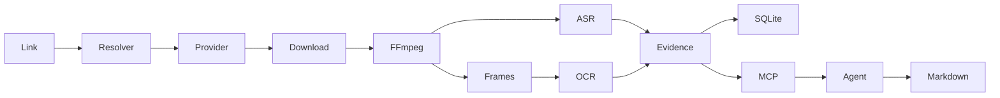

# AgentMediaLens

**Multimodal Media Understanding Infrastructure for AI Agents.** Give Agents the Ability to Understand Media.

[简体中文](README.zh-CN.md) · [v0.1.0 report](docs/releases/v0.1.0.md) · [Architecture](docs/architecture/overview.md)

AgentMediaLens prepares local evidence from public Douyin videos, photo notes, Live Photos and Bilibili videos. Videos have timestamped speech and keyframes. Albums have page-indexed images, motion samples and OCR. Codex can request individual JPEGs and write its interpretation to Markdown. The installed Codex plugin analyzed a real 28-second public video, read its images and wrote a time-cited report. Live cases also cover English speech, a Mandarin software tutorial and footage without speech.



## Analyze a work or make an original

Share a supported public link; there is no required genre or creative brief. If you want to create, describe your target and materials in your own words. Source format and target format can differ.

| Try asking the plugin | Output |
|---|---|
| “Analyze this work: [link].” | Evidence-cited analysis of editing, content, viewpoint and possible audience. No creative brief required. |
| “Compare this creator’s high-like and ordinary posts. I want to make something similar.” | A scoped comparison plus two or three original directions, with material requirements and a first shot for each. |
| “Use this as a reference for a 60-second software explainer; I only have screen recordings.” | A separate production plan: title, cover, two openings and a timed shot list with visuals, lines/audio, captions and edits. |

Preview the metadata selection with `media-lens compare "$PROFILE_URL" --sample-size 12 --pairs 1`. The connected agent inspects actual frames/transcripts and writes the reports. CLI selection alone does not generate prose or render a video. The MCP prompt `study_media` also accepts optional free-text target and constraints. [Study contract](docs/architecture/data-contracts.md#creator-studies)

## Creator profiles

Run `media-lens profile "$PROFILE_URL" --count 5` for either platform, or call `media_list_profile` from the plugin. It returns canonical links, titles, upload times, duration and the available engagement counts without opening a browser. Use the returned view and cursor to continue. A collection has a separate scope from all uploads. [Profile contract](docs/architecture/data-contracts.md). For opt-in, browser-free Douyin upload queries with a locally reserved login, see [setup and revocation](docs/providers/douyin.md#optional-local-login-for-public-uploads).

## Install from source

Use Node 24 LTS (24.12+), pnpm 11.5, Python 3.12, uv, FFmpeg/ffprobe, and Tesseract with eng and chi_sim. On Debian/Ubuntu install ffmpeg, tesseract-ocr-eng and tesseract-ocr-chi-sim. On macOS Homebrew provides ffmpeg, tesseract and tesseract-lang. The runtime stores weights separately and downloads a missing Whisper model on first voiced analysis.

```sh
git clone https://github.com/1122414/agent-media-lens.git
cd agent-media-lens
pnpm install --frozen-lockfile
uv sync --frozen --python 3.12
pnpm build
sh scripts/install-launchers.sh
export PATH="$HOME/.local/bin:$PATH"
media-lens doctor
```

Doctor checks local binaries and the configured provider. For Evil0ctal it exits with status 1 if the API is unreachable, the key lacks access, or the selected platform has no available guest identities. Use `media-lens doctor --platform bilibili` to check Bilibili. An OK check does not establish download permission for a particular video. Link identification and existing-task evidence reads work independently.

## Providers and configuration

Follow the [Douyin setup](docs/providers/douyin.md) for an independent Evil0ctal v5 service. For BV, av, b23.tv and multi-part videos, follow the [Bilibili guide](docs/providers/bilibili.md). Keep the key scoped to the required platforms in EVIL0CTAL_API_KEY. Pass a JSON config path via MEDIA_LENS_CONFIG. Set MEDIA_LENS_CACHE and EVIL0CTAL_ENDPOINT to override the file. The optional MEDIA_LENS_PYTHON selects a worker interpreter. Run `media-lens config` to print effective settings. Keys never appear in config output.

| Setting | Default | Purpose |
|---|---|---|
| provider / fallback | evil0ctal / false | Choose provider; optional native fallback on connection failure |
| endpoint | http://127.0.0.1:8000 | Trusted v5 origin |
| cacheDir | ~/.cache/agent-media-lens | Private task directory and SQLite database |
| maxSeconds / maxBytes | 600 / 500000000 | Metadata, download and decode bounds |
| maxDiskBytes / concurrency | 10000000000 / 1 | Task admission |
| retentionDays | 7 | Expiry of original video at admission or explicit cleanup |
| interval / maxFrames | 4 seconds / 30 | Baseline sampling and frame cap |
| model / device | auto / auto | CPU base int8 or CUDA small FP16; manual overrides supported |
| ocrLang | chi_sim+eng | Installed Tesseract languages |

```sh
media-lens identify "$SHARE_URL"
media-lens resolve "$SHARE_URL"
media-lens analyze "$SHARE_URL" --model base --max-frames 12
media-lens task "$TASK_ID"
media-lens transcript "$TASK_ID"
media-lens frames "$TASK_ID" --markdown
media-lens result "$TASK_ID"
media-lens cleanup
```

When a user has rights to keep a video file, run `media-lens analyze "$SHARE_URL" --keep-playback` or pass `keepPlayback: true` to `media_analyze`. The result identifies the actual rendition and its path under the task directory. Creator-enabled downloads are cached for seven days by default. When the save button is disabled or unknown, ordinary guest playback can still be analyzed. By default its working file is deleted after processing. Use `--discard-original` to discard either rendition. A guest stream is a platform encode; camera masters are outside this interface.

## Codex and other MCP clients

From the checkout, install the launchers, ensure the desktop app can find media-lens-mcp on PATH, and run:

```sh
codex plugin marketplace add .
codex plugin add agent-media-lens@agent-media-lens-local
codex plugin list --marketplace agent-media-lens-local --json
```

Start a fresh chat. Ask “Summarize this public Douyin video and cite the relevant frames”, or “Analyze existing task TASK_ID”. The skill reads the transcript, samples images on demand and saves analysis.md beside the result. A generated tutorial example produced “Open the settings menu [0–4s]” supported by a white card reading “STEP ONE OPEN SETTINGS” [0s · f000]. See [verification](docs/development/testing.md).

For other stdio clients configure `{"mcpServers":{"media":{"command":"media-lens-mcp"}}}` and pass the operator environment to the process. See [tool reference](docs/architecture/data-contracts.md).

## Docker

```sh
docker compose build
docker compose run --rm lens --help
docker compose run --rm -T --entrypoint node lens dist/apps/mcp-server/main.js
```

The core has no published port. Files and models persist in the media-data volume. For a remote provider, set an operator-controlled HTTPS endpoint reachable from the container. If both services run on the **same Docker engine**, [start the local provider](docs/providers/douyin.md), export its read-only API key, then run:

```sh
export LENS_PROVIDER_CONTAINER="$(docker compose -f providers/douyin/compose.yaml ps --status running -q api)"
docker compose -f compose.yaml -f compose.local-provider.yaml run --rm -T lens doctor
```

The override makes loopback reach the running API by sharing its network namespace. It grants no access to the API filesystem or its credentials and publishes no additional port. Repeat the lookup if the API container is recreated. On Homebrew installations with the standalone Compose binary, substitute `docker-compose`.

## FAQ

- **A share opens a photo note.** Resolve reports each page as still or live. Analyze extracts one poster per page and two motion frames per live page. Use frames --page N or the MCP page filter. Album inputs are transient; evidence and OCR remain.
- **Why did the adapter refuse a playable link?** Resolve requires confirmed public visibility. Analysis also needs a guest-accessible media address. Login requirements, removal, expired CDN links and platform refusals can stop a specific task. The share-menu save setting is reported separately.
- **Can I use native only?** It identifies direct and shortened shares. Native metadata and downloads report NATIVE_UNSUPPORTED.
- **Where is analysis saved?** Each UUID directory contains result.json, transcript.json, evidence.json, JPEGs and analysis.md. Read cached media only in a private directory owned by the operator. No per-user access control is provided for a shared cache.
- **What happens when disk admission fails?** Cleanup expires originals; derived evidence remains. Archive terminal task directories offline before manually removing them. Stop running clients before editing the cache.

[Roadmap](ROADMAP.md) · [Contributing](CONTRIBUTING.md) · [Security](SECURITY.md) · [Apache-2.0](LICENSE)
