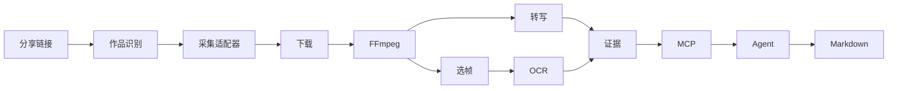

# AgentMediaLens

面向 AI Agent 的本地多媒体理解基础设施。输入公开抖音作品链接，获得带时间戳的逐字稿、关键帧、画面文字和 Markdown 分析。当前处于开发版。已用独立 Codex 客户端验证了合成教程的图像读取和语音分析。真实平台视频验收进度见[实施状态](IMPLEMENTATION_STATUS.md)。

[English](README.md) · [架构图和模块关系](ARCHITECTURE.md) · [技术选型](TECH_STACK.md)



## 安装

准备 Node 24.12+（24.x）、pnpm 11.5、Python 3.12、uv、FFmpeg、ffprobe 和 Tesseract。OCR 需要 chi_sim 与 eng 语言包。第一次转写会按需下载模型，可提前准备缓存。

```sh
git clone https://github.com/1122414/agent-media-lens.git
cd agent-media-lens
pnpm install --frozen-lockfile
uv sync --frozen --python 3.12
pnpm build
sh scripts/install-launchers.sh
export PATH="$HOME/.local/bin:$PATH"
media-lens doctor
```

按[采集服务说明](docs/providers/douyin.md)启动独立的 Evil0ctal v5，给本地进程设置 EVIL0CTAL_ENDPOINT 和 EVIL0CTAL_API_KEY。如果 Evil0ctal 不可达、密钥缺失或无权限，或抖音身份池没有可调度身份，doctor 返回退出码 1。检查通过只说明本机配置可用，具体作品仍需验证下载权限。可先运行 identify 识别分享链接。

## CLI、插件与容器

```sh
media-lens identify "$SHARE_URL"
media-lens resolve "$SHARE_URL"
media-lens analyze "$SHARE_URL"
media-lens task "$TASK_ID"
media-lens transcript "$TASK_ID"
media-lens frames "$TASK_ID" --markdown
media-lens result "$TASK_ID"
media-lens cleanup
codex plugin marketplace add .
codex plugin add agent-media-lens@agent-media-lens-local
codex plugin list --marketplace agent-media-lens-local --json
```

在新对话中发出“总结这个公开视频，引用画面和口播时间”，或指定已有任务。示例验收中，Codex 在第 0 秒的 f000 看到了白底黑字的 OPEN SETTINGS 卡片，将它与 0–4 秒的打开设置、保存文件口播对应，并保存了 analysis.md。其他 Agent 可用 stdio 配置 `{"mcpServers":{"media":{"command":"media-lens-mcp"}}}`。

```sh
docker compose build
docker compose run --rm lens --help
docker compose run --rm -T --entrypoint node lens dist/apps/mcp-server/main.js
```

容器将素材和模型保存在 media-data 卷。容器内的 127.0.0.1 指向容器自身，真实处理需提供容器可达的受信 HTTPS 采集服务。Homebrew 单独安装 Compose 时，可用 docker-compose。

## 配置与常见问题

- 用 MEDIA_LENS_CONFIG 指定 JSON 文件，用 MEDIA_LENS_CACHE 覆盖缓存目录，运行 media-lens config 查看生效配置。默认并发 1、时长 600 秒、单文件 500 MB、缓存预算 10 GB、原片保留 7 天。启动新任务或运行 cleanup 时清除过期原片。
- 单次分析可加 --discard-original，处理结束即清理原片；MCP 对应字段为 discardOriginal。
- 初始抽帧间隔 4 秒，上限 30 帧；普通 CPU 默认 base/int8。可设置 interval、maxFrames、model、device 和 ocrLang。字段与默认值见[英文配置表](README.md)。
- 遇到图文作品，identify 可返回 ID，视频分析会返回 UNSUPPORTED_MEDIA。原生适配器目前可解析链接，元数据和下载依赖外部服务。
- 作品可观看但不可下载时，适配器会拒绝继续。状态缺失、私密、服务凭证失效或访问限制均可能阻止采集。切勿把密钥、Cookie 和原始媒体提交到仓库。
- 每个任务的 UUID 目录保存 result.json、transcript.json、关键帧和 analysis.md。结构化结果可按时间和帧 ID 追溯。

[接口文档](docs/architecture/data-contracts.md) · [路线图](ROADMAP.md) · [参与贡献](CONTRIBUTING.md) · [许可证](LICENSE)
