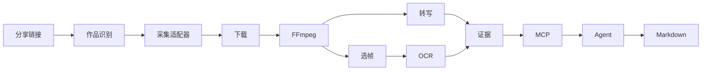

# AgentMediaLens

面向 AI Agent 的本地多媒体理解基础设施。输入抖音视频、图文、实况照片或 B 站视频链接。视频按时间读取口播与画面；图集按页读取静态图、动态采样和画面文字。已用独立 Codex 客户端分析一条 28 秒的真实作品，读到实际图片并写出带时间戳的报告。中文软件教程、英文口播和无口播素材也已在真实平台验证。详见[实施状态](IMPLEMENTATION_STATUS.md)。

[English](README.md) · [v0.1.0 验收与安装报告](docs/releases/v0.1.0.md) · [架构图和模块关系](ARCHITECTURE.md) · [技术选型](TECH_STACK.md)



## 读取作者主页

把 B 站空间或抖音用户主页链接发给插件，或运行以下命令。目录查询无需打开浏览器或下载视频。

```sh
media-lens profile "$PROFILE_URL" --count 5
media-lens profile "$PROFILE_URL" --view posts --count 5 --cursor "$NEXT_CURSOR"
media-lens profile "$PROFILE_URL" --view collections
media-lens profile "$PROFILE_URL" --view collection --collection-id "$COLLECTION_ID"
```

每条记录包含作者、作品链接、标题、发布时刻、时长和公开互动数。点赞、播放、评论、收藏或分享未公开时显示 null。默认补查缺失点赞的作品详情，可加 `--list-only` 只读目录。返回 `view=collection` 表示作品来自指定合集，`postListError` 会说明投稿列表是否受限。抖音访客有时只能读取第一页。

## 安装

准备 Node 24.12+（24.x）、pnpm 11.5、Python 3.12、uv、FFmpeg、ffprobe 和 Tesseract。OCR 需要 chi_sim 与 eng 语言包。第一次转写会按需下载模型，可提前准备缓存。

```sh
git clone https://github.com/1122414/agent-media-lens.git
cd agent-media-lens
pnpm install --frozen-lockfile
uv sync --frozen --python 3.12
pnpm build
sh scripts/install-launchers.sh
export PATH="$HOME/.local/bin:$PATH"
media-lens doctor
```

按[采集服务说明](docs/providers/douyin.md)启动独立的 Evil0ctal v5，给本地进程设置 EVIL0CTAL_ENDPOINT 和 EVIL0CTAL_API_KEY。如果 Evil0ctal 不可达、密钥缺失或无权限，或抖音身份池没有可调度身份，doctor 返回退出码 1。检查通过只说明本机配置可用，具体作品仍要检查访客能否读取详情和媒体。可先运行 identify 识别分享链接。

## CLI、插件与容器

```sh
media-lens identify "$SHARE_URL"
media-lens resolve "$SHARE_URL"
media-lens analyze "$SHARE_URL"
media-lens task "$TASK_ID"
media-lens transcript "$TASK_ID"
media-lens frames "$TASK_ID" --markdown
media-lens result "$TASK_ID"
media-lens cleanup
codex plugin marketplace add .
codex plugin add agent-media-lens@agent-media-lens-local
codex plugin list --marketplace agent-media-lens-local --json
```

在新对话中发出“总结这个公开视频，引用画面和口播时间”，或指定已有任务。示例验收中，Codex 在第 0 秒的 f000 看到了白底黑字的 OPEN SETTINGS 卡片，将它与 0–4 秒的打开设置、保存文件口播对应，并保存了 analysis.md。其他 Agent 可用 stdio 配置 `{"mcpServers":{"media":{"command":"media-lens-mcp"}}}`。

```sh
docker compose build
docker compose run --rm lens --help
docker compose run --rm -T --entrypoint node lens dist/apps/mcp-server/main.js
```

容器将素材和模型保存在 media-data 卷。若使用远程服务，请配置容器可达的受信 HTTPS 地址。若 Core 与采集服务使用**同一 Docker 引擎**，按[部署说明](docs/providers/douyin.md)启动采集服务，把只读密钥设为环境变量后执行：

```sh
export LENS_PROVIDER_CONTAINER="$(docker compose -f providers/douyin/compose.yaml ps --status running -q api)"
docker compose -f compose.yaml -f compose.local-provider.yaml run --rm -T lens doctor
```

该配置让 Core 与 API 共享网络，因此回环地址能直接访问 API，无需开放新端口。两者的文件系统和凭证仍然独立。API 容器重建后须重新获取 ID。Homebrew 单独安装 Compose 时，可用 `docker-compose` 替代 `docker compose`。

## 配置与常见问题

- 用 MEDIA_LENS_CONFIG 指定 JSON 文件，用 MEDIA_LENS_CACHE 覆盖缓存目录，运行 media-lens config 查看生效配置。默认并发 1、时长 600 秒、单文件 500 MB、缓存预算 10 GB、原片保留 7 天。启动新任务或运行 cleanup 时清除过期原片。
- 单次分析可加 --discard-original，处理结束即清理原片；MCP 对应字段为 discardOriginal。
- 初始抽帧间隔 4 秒，上限 30 帧；普通 CPU 默认 base/int8。可设置 interval、maxFrames、model、device 和 ocrLang。字段与默认值见[英文配置表](README.md)。
- B 站支持 BV、av 视频链接和 b23.tv 短链，保留指定的分 P。给采集服务密钥配置 `bilibili:read`，用 `media-lens doctor --platform bilibili` 核对。访客可读的单文件 MP4 可直接分析，默认每 P 最长 10 分钟。详见 [B 站适配说明](docs/providers/bilibili.md)。
- 图文和实况照片按页分析，静态页生成一张 JPEG，实况页额外生成两帧动态证据。用 frames <任务号> --page 3 或 MCP 的 page 参数读取第三页，静态页没有时间戳。原生适配器目前可解析链接，元数据和下载依赖外部服务。
- 抖音关闭「保存本地」时，仍可分析访客正常观看的播放流。需要保留有权保存的副本时，运行 `media-lens analyze "$SHARE_URL" --keep-playback`，或在 MCP 传 `keepPlayback: true`。结果里的 `playbackPath` 指向播放版本，`sourcePath` 指向平台提供的下载版本，路径均相对于任务目录。只有公开详情时可用 resolve 读元数据。私密、已删除、需要登录或平台拒绝访问的作品会返回错误。
- 每个任务的 UUID 目录保存 result.json、transcript.json、关键帧和 analysis.md。结构化结果可按时间和帧 ID 追溯。

[接口文档](docs/architecture/data-contracts.md) · [路线图](ROADMAP.md) · [参与贡献](CONTRIBUTING.md) · [许可证](LICENSE)
