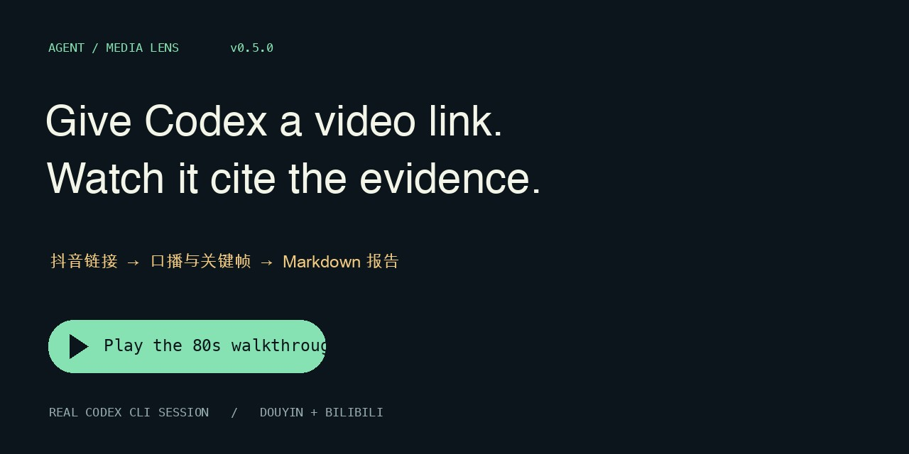

# Watch Codex read a video

[80-second MP4](https://github.com/1122414/agent-media-lens/releases/download/v0.5.0/walkthrough.mp4) · [Chinese captions](captions.zh.vtt) · [selected evidence from the run](session.json)

This silent, captioned demo is an edited replay of a real Codex CLI session using the installed plugin. The UI renders selected tool calls and results from that session; waits are shortened. It is not a capture of the Codex Desktop UI. No third-party source footage or audio is distributed. The settings card explicitly marked **CONTROL** is an original local test clip, decoded and read back via the same MCP JPEG tool. The separately completed Bilibili analysis is labelled as a follow-up.

| Time | Actual operation |
|---|---|
| 0:00 | Give Codex a public Douyin link and request evidence with timestamps. |
| 0:08 | Resolve visitor playback, fetch the 28-second working copy, transcribe and remove the temporary input. |
| 0:19 | Read the timestamped transcript. The first segment runs from 0–3.16 seconds; later words are uncertain. |
| 0:29 | Ask for f005: an actual 44,194-byte JPEG from 27s. The onscreen settings card is a separate example; the Douyin frame is identified by its checksum in the evidence file. |
| 0:40 | Save Markdown tying a speech observation to 0–3.16s and a visual observation to f005 at 27s. |
| 0:52 | Read six public videos in one Bilibili creator collection and select a pair by observed likes. This is not a claim about all uploads or watch completion. |
| 1:03 | Resolve a Bilibili BV. A separate analysis of the same work yielded 294 speech segments and three sampled frames. |
| 1:13 | Install and verify the runtime, then configure the reader for new platform links. |

Try in a new Codex chat after [installing](../../README.md#install-on-macos-or-linux): “Analyze this public link. Read the transcript and one actual frame, cite their times, and save the report.” Guest results and engagement counts may change.
